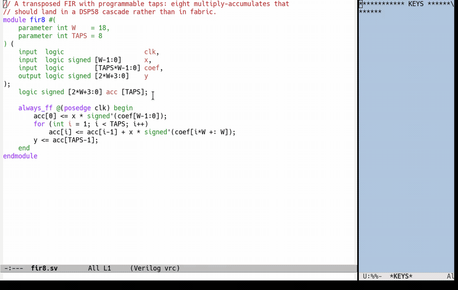

# vrc.el

Send Tcl from an Emacs buffer to a Vivado session that `vrc` holds open, watch
the synthesis in a second buffer, and jump from Vivado's errors into the RTL
that caused them. Put point in a module, press `C-c v o`, and forty seconds
later the echo area says how much timing your last edit cost:

```
WNS=-0.313 from=acc_reg[0]/DSP58C<0>_INST/DSP_M_DATA58_INST/CLK
to=acc_reg[1]/DSP58C<0>_INST/DSP_OUTPUT58_INST/ALU_OUT[10] levels=6
(was 0.248, -0.561)
```



That is one real session, sped up: `C-c v o` synthesises the module at point,
the log follows Vivado while it works, then `W` changes from 18 to 35 and
`C-c v g` runs the same script again. Forty seconds each way, and the
comparison at the end is the only thing you had to read.

Emacs never holds a connection. Each evaluation runs `vrc -s NAME -f -` with
the script on its standard input, so a session that is stopped and restarted
on a new port is followed for free, and the token never leaves that short-lived
process. Nothing blocks: a half-hour synthesis runs in the background while you
keep editing.

## Install it

The package has no dependencies beyond Emacs 28 and a `vrc` on `PATH`.

```elisp
(add-to-list 'load-path "~/git/vivado-remotectl/contrib/emacs")
(require 'vrc)
(add-hook 'tcl-mode-hook #'vrc-mode)
(add-hook 'verilog-mode-hook #'vrc-mode)
```

With one session running you need no configuration at all — the mode finds it.
Everything else hangs off `C-c v`, a single user-reserved prefix rather than
the usual `C-c C-<letter>` bindings, because verilog-mode and vhdl-mode have
already taken every one of those worth having.

## Synthesise the module you are looking at

Take an eight-tap transposed FIR with programmable coefficients, which should
land in a DSP58 cascade rather than in fabric:

```systemverilog
module fir8 #(parameter int W = 18, parameter int TAPS = 8) (
    input  logic                     clk,
    input  logic signed [W-1:0]      x,
    input  logic        [TAPS*W-1:0] coef,
    output logic signed [2*W+3:0]    y
);
    logic signed [2*W+3:0] acc [TAPS];

    always_ff @(posedge clk) begin
        acc[0] <= x * signed'(coef[W-1:0]);
        for (int i = 1; i < TAPS; i++)
            acc[i] <= acc[i-1] + x * signed'(coef[i*W +: W]);
        y <= acc[TAPS-1];
    end
endmodule
```

The part and the constraints belong with the project rather than in your init
file, so put them in `.dir-locals.el` beside the RTL:

```elisp
((nil . ((vrc-ooc-part . "xcvc1902-vsva2197-2MP-e-S")
         (vrc-ooc-xdc  . "ooc.xdc"))))
```

Now `C-c v S` starts a session in this directory and `C-c v o` synthesises the
module around point out of context. The first run reports a number:

```
WNS=0.248 from=acc_reg[6]/DSP58C<0>_INST/DSP_OUTPUT58_INST/CLK
to=acc_reg[7]/DSP58C<0>_INST/DSP_OUTPUT58_INST/ALU_OUT[10] levels=3
```

Add an asynchronous reset to that `always_ff` — the kind of change that looks
free in review — and press `C-c v g`, which saves every buffer and runs the
same script again. The comparison is done for you:

```
WNS=-0.313 ... levels=6 (was 0.248, -0.561)
```

Half a nanosecond, and the logic levels went from three to six. The DSPs are
still there; what went is the output register, because a DSP58 cannot absorb
an asynchronous reset and the adder had to come out into fabric.

## Look at the design that is now open

The design stays loaded between evaluations, which is the whole point of a
session, so the follow-up questions cost nothing. `C-c v e` takes one line of
Tcl in the minibuffer and prints what it returned:

```tcl
report_utilization -return_string
```

That confirms where the arithmetic went — eight DSP58 slices and not one LUT:

```
| CLB LUTs*               |    0 |
|   DSP58                 |    8 |
```

Read those rows rather than counting cells. `get_cells -hier -filter {REF_NAME
=~ DSP*}` answers **112** for this design, because it counts the primitives
inside each DSP58 rather than the slices, and that number will find its way
into a commit message if you let it.

Worth the second look, too: widening `W` from 18 to 27 *improves* WNS to 0.564
while quietly spending 1514 LUTs, because the accumulator stopped fitting the
DSP and moved into fabric. A run that only reports timing would have called
that an improvement.

Longer scripts belong in a scratch `.tcl` buffer: write them there, send a
paragraph with `C-c v r`, and keep the ones that were useful. `C-c v t` shows
the transcript of everything sent to the session and what came back.

## See what Vivado said

The Tcl result is all that crosses the socket — `puts`, progress, and every
`INFO:`/`WARNING:`/`ERROR:` message go to the session log instead. `C-c v l`
opens that log in a buffer that follows it a quarter of a second behind, and a
job still running after five seconds opens it for you.

It is a compilation buffer, so any message carrying a source location is live.
`M-g M-n` visits the errors of the current run — ignoring what an eight-hour
session said earlier — and lands on the line:

```
ERROR: [Synth 8-2716] syntax error near 'y' [/home/you/rtl/broken.sv:5]
```

Warnings and info lines stay clickable but `M-g M-n` steps over them, which is
what you want in a log that prints a few hundred of them. Scrolling back to
read one stops the buffer following until you return to the end, so you can
read an error without the next line of output yanking you away from it.

## When it is not your buffer's session

With several sessions running, say which one a buffer means. `vrc-session` is a
safe file-local, so the baseline checkout and the working tree each get their
own and the same key does the right thing in both:

```elisp
;; .dir-locals.el in the baseline checkout
((nil . ((vrc-session . "baseline"))))
```

`C-c v s` sets it for one buffer, `C-c v L` lists what is running, and `C-c v Q`
stops one. A buffer that simply latched onto the only session forgets the name
again when it stops naming anything, so starting a replacement under a
different name does not leave you talking to a ghost.

## The keys

| key | does |
|---|---|
| `C-c v r` `C-c v b` `C-c v v` | evaluate the region, the buffer, or the command at point |
| `C-c v e` | evaluate one line read from the minibuffer |
| `C-c v f` | `source` the file this buffer is visiting |
| `C-c v o` | synthesise the module at point out of context |
| `C-c v g` | save everything and run the last script again |
| `C-c v l` `C-c v t` | the session log, the transcript |
| `C-c v z` | a prompt on the session |
| `C-c v k` | stop waiting for a job |
| `C-c v s` `C-c v S` `C-c v Q` `C-c v L` | select, start, stop, list sessions |

In `tcl-mode` buffers, where nothing collides, `C-c C-r`, `C-c C-x` and
`C-c C-z` work as tcl.el taught your fingers.

Vivado runs one script at a time, so a second evaluation during a synthesis is
refused rather than queued behind twenty-five minutes of work. `C-c v k`
detaches this end only and the script keeps going, which is why a long one
should `puts` its result as well as `return` it, so the answer remains in the
log either way. `vrc cancel` from a shell stops the script itself and keeps the
session.

## Settings

| variable | for |
|---|---|
| `vrc-session` | which session this buffer talks to (file-local) |
| `vrc-ooc-part` `vrc-ooc-xdc` `vrc-ooc-sources` | what `C-c v o` synthesises against (file-local) |
| `vrc-ooc-template` | the Tcl it runs, if your flow is not the usual one |
| `vrc-start-args` | extra arguments for `C-c v S`, such as `--version` |
| `vrc-show-log-delay` `vrc-log-backlog` | when the log appears and how much of it |
| `vrc-notify-after` | seconds before a finished job raises a desktop notification |

`vrc-ooc-template` starts with `close_design -quiet` **and**
`close_project -quiet`. The second one matters: files read with `read_verilog`
land in an implicit in-memory project and stay there, so without it a session
that has synthesised before keeps the old file's definition of the module,
says so as a critical warning in a log nobody is reading, and hands you the
previous design's timing.

## Run the tests

The evaluation tests need a session, and a fake Vivado is enough — it runs the
real plugin on a `tclsh` you point it at, with no Vivado process and no
hardware. Use the host's `tclsh8.6`, or the one inside an install (`tclsh8.5`
in 2023.2 and older, where `try` and `lmap` do not exist).

```console
$ export VRC_TEST_TCLSH=$(command -v tclsh8.6)
$ vrc start emacstest --vivado "$PWD/tests/fake_vivado.sh"
emacstest: listening on 127.0.0.1:38161 (pid 3176760)

$ VRC_TEST_SESSION=emacstest emacs -Q --batch -L contrib/emacs \
      -l contrib/emacs/vrc-tests.el -f ert-run-tests-batch-and-exit
Ran 21 tests, 21 results as expected, 0 unexpected (1.064463 sec)
```

Without `VRC_TEST_SESSION` the live tests skip and the parsing ones still run.
The one that matters most is `vrc-test-eval-multiline`: a region containing a
`foreach` has to arrive as one script. That is why evaluation goes through
`vrc -f -` and not through the prompt — `vrc repl` reads a line at a time, so
an editor sending a block through it would split the block. The prompt at
`C-c v z` is for one-liners.
